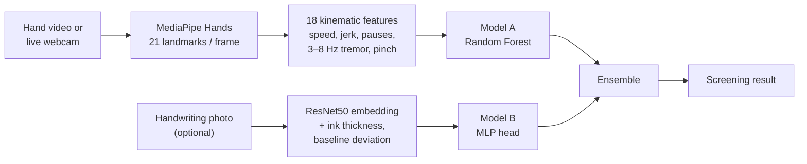

# Dysgraphia Screening Prototype

**First Prize, Southern Region (Category B, high school) – National Youth Creativity Competition in Artificial Intelligence 2026; selected for the national final**

A web application that helps teachers and parents spot early signs of **dysgraphia** (a learning difficulty that affects handwriting) in primary-school children. It looks at two things:
- **how the child's hand moves while writing**, from an uploaded video or a live webcam;
- **what the handwriting looks like**, from a photo.

Each is scored by its own model, and the two results are combined into one screening result.

> ⚠️ **This is a research prototype, not a medical device.** Its output is a screening aid that suggests whether a child may benefit from a professional assessment. It does not diagnose dysgraphia.

> 🇻🇳 Vietnamese developer notes, including known issues and migration test logs, are in **[README.vi.md](README.vi.md)**. The app's interface is in Vietnamese.

---

## How it works



**Model A: hand movement (required).** [MediaPipe Hands](https://developers.google.com/mediapipe) tracks 21 hand landmarks in each frame. From these, 18 kinematic features are computed: speed, acceleration, jerk, pause ratio, tremor energy in the 3–8 Hz band, pinch distance and others. A Random Forest turns the features into a risk score. If the hand stays still or stays clenched, the "movement gate" returns a risk score of 0 instead of an unreliable prediction. At least 5 frames with a visible hand are required.

**Model B: handwriting image (optional).** A ResNet50 backbone produces a 2,048-dimensional image embedding. Two hand-crafted features are added: average ink thickness and deviation from the writing baseline. A small MLP head (2,050 → 128 → 32 → 1, sigmoid) outputs a probability. Inference runs on ONNX Runtime, with a PyTorch fallback.

**Ensemble.** The two models vote. If they disagree, their probabilities are averaged and compared with a 0.5 threshold. Without a photo, Model A decides alone.

## Tech stack

| Layer | Tools |
|---|---|
| Frontend | Next.js 16, TypeScript, Tailwind CSS (Vietnamese UI), MediaPipe JS for the live camera |
| Backend | FastAPI, with session history stored in local CSV files |
| Machine learning | MediaPipe Hands, scikit-learn (Random Forest), PyTorch / ONNX Runtime (ResNet50 + MLP) |

## Getting started

**Requirements:** Python 3.11+ (tested with 3.12) and Node.js LTS (tested with 24.x). An internet connection is needed on the first run, to download the ResNet50 weights and the MediaPipe JS library.

```bash
# Backend (http://127.0.0.1:8000, API docs at /docs)
python -m venv .venv
.venv\Scripts\activate          # Windows; use `source .venv/bin/activate` on macOS/Linux
pip install -r requirements.txt
uvicorn backend.main:app --reload --port 8000

# Frontend (http://localhost:3000) — in a second terminal
cd frontend
npm install
npm run dev
```

On Windows, `.\run-dev.ps1` starts both servers in one step. It also accepts `-Attach`, `-Status` and `-Stop`.

`mediapipe` is pinned to 0.10.14 because later versions removed the `solutions.hands` module the backend uses.

## API

| Method | Path | Description |
|---|---|---|
| `POST` | `/api/screening` | Full screening (video or live landmarks, plus an optional image). The session is saved |
| `POST` | `/api/screening/model-a` | Model A only, not saved |
| `POST` | `/api/screening/model-b` | Model B only (image), not saved |
| `GET` | `/api/health` | Service status |
| `GET` | `/api/history?limit=50` | Recent sessions |
| `GET` | `/api/history/{session_id}` | One session's Model A, Model B and ensemble results |

## Project structure

```
frontend/    Next.js app: screening, results, history and about pages
backend/
  routes/    screening and history endpoints
  services/  Model A, Model B and ensemble services
  ml/        kinematic features, image features, model adapters, ONNX / PyTorch inference
  tests/     32 tests for the services, API and kinematics
weights/     trained models and scalers
```

## Testing

```bash
python -m pytest backend/tests -v
cd frontend && npm run lint && npm run build
```

## Privacy and responsible use

- The app is meant to be used with the consent of the child's parent or guardian.
- Screening sessions are stored only on the machine running the backend, in `data/`. This folder is excluded from Git.
- The results are probabilistic. A high risk score should lead to a referral to a specialist, not a label.

## Known limitations

- After a page reload, the results page cannot yet show Model A's probability or video-quality details again, because they are not stored.
- The Model B scaler assumes a fixed order for the two hand-crafted features. This order was inferred from the saved files, not confirmed against a training script.
- The model training code is not included in this repository.

## Team

Developed by a three-student team: [DavBao-dev](https://github.com/DavBao-dev), [Liamislazy](https://github.com/Liamislazy) and [s4dz](https://github.com/s4dz) (team leader).
